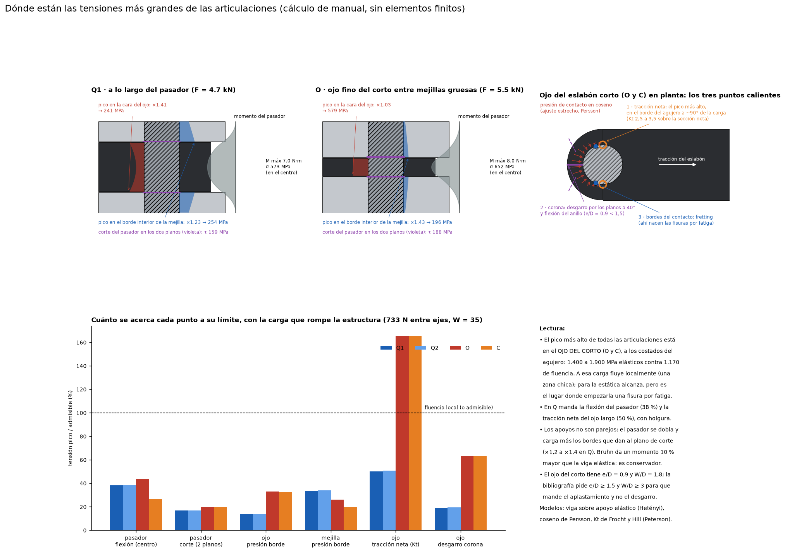

# Articulaciones: qué dice la bibliografía y dónde están las tensiones más grandes

Este informe junta dos cosas:
- qué dice la bibliografía sobre cómo hacer pivotes chicos, precisos y robustos;
- dónde están los picos de tensión en Q1, Q2, O y C, calculados con esos métodos.

El cálculo está en `articulaciones_esfuerzos.py` y los resultados en `salida/articulaciones_esfuerzos.json`.

Todos los métodos son de manual, sin elementos finitos. Las cargas son las de **W = 35**, con la carga entre ejes que rompe la estructura (733 N, limitada por la barra A). A esa carga, en los pivotes:

| Pivote | Fuerza |
|---|---:|
| Q1 | 4,7 kN |
| Q2 | 4,7 kN |
| O | 5,5 kN |
| C | 5,5 kN |

## 1. Qué dice la bibliografía

### Los modos de falla de una unión con pasador

El método clásico es el de la Fuerza Aérea de EE.UU. (*Stress Analysis Manual*, AFFDL), que viene de Melcon y Hoblit (1950 y 1953) y está recogido en Bruhn y en ESDU 91008. Revisa por separado:

**En la orejeta (el ojo, o cada mejilla):**
1. **Tracción en la sección neta**, a los costados del agujero.
2. **Desgarro** por dos planos a ~40° hacia la corona, es decir, el material delante del pasador.
3. **Aplastamiento** en el contacto con el pasador.
4. **Rotura de la corona** en un solo plano, por tracción tangencial.

**En el pasador:**
- corte en los dos planos;
- flexión, con un brazo de palanca que depende de los espesores y del juego entre capas.

Las proporciones del ojo deciden cuál de estos modos manda. Con **e/D < 1,5** (e: distancia del centro del agujero al borde) mandan el desgarro y la rotura de la corona; con e/D ≥ 1,5, el aplastamiento. La bibliografía paramétrica muestra que, por encima de **W/D ≈ 4 y e/D ≈ 3**, la tensión máxima ya casi no baja al agrandar el ojo.

### Flexión del pasador

- Bruhn toma el brazo como **t_mejilla/2 + juego + t_ojo/4**. Es lo que ya usábamos y es conservador.
- El manual de la Fuerza Aérea aclara que, si el pasador es flexible, la carga se va hacia los bordes que dan a los planos de corte. Eso reduce el momento, pero "rara vez más de un 25 %".
- También advierte que esos bordes, muy cargados, son donde puede empezar una rotura.

### El ajuste es lo que más pesa en el pico de tensión del agujero

- **El juego aumenta la concentración de tensiones** frente a un ajuste justo (Strozzi, Ciavarella y colaboradores, ábacos de 2006 y 2011).
- La interferencia la baja "considerablemente" (estudio paramétrico de 1994).
- Con juego, el contacto se achica y la presión se concentra en una franja angosta: daño superficial y fatiga.
- Con ajuste justo, la presión alrededor del agujero se reparte **en coseno** (Persson; Ciavarella y Decuzzi). El pico, en el fondo del contacto, es 4/π veces la presión nominal.

### Fatiga y fretting en 7075

- En placas de 7075-T6 con pasador, las fisuras **nacen por fretting** en los bordes del contacto (Universidad de Bath).
- La interferencia alarga la vida a la fatiga.
- Los bujes con interferencia bajan la velocidad de propagación de fisuras (ASTM STP 1983).
- Pero en la interfaz zunchada aparece óxido de fretting, y ahí nacen las fisuras (*Tribology International*, 2023).
- En orejetas de ala de caza se encontraron roturas por fretting entre el buje y la orejeta (1990).

### Gripado entre aceros inoxidables

- **17-4PH H900 contra sí mismo gripa con apenas ~17 MPa** (2,4 ksi en el ensayo ASTM G98 de Bodycote). Con un tratamiento superficial sube a ~760 MPa.
- El 440C se comporta bien frente a casi cualquier pareja.
- La regla de "diferencia de dureza grande" está discutida; lo que importa es el par de materiales.

### Práctica en bisagras de avión

- Pasador duro sobre buje reemplazable, con grasa.
- Las piezas de desgaste se diseñan para que el desgaste caiga en ellas y no en la estructura.
- Comentarios de usuarios, no guía técnica: hay manuales que prohíben aceitar ciertas bisagras porque el aceite junta polvo y acelera el desgaste.

Las fuentes sobre agujeros en línea, coaxialidad y juego admisible son manuales de reparación y normas que no encontré abiertas. Las recomendaciones de ese tipo de este informe son práctica habitual, no citas.

## 2. Dónde están los picos en nuestras articulaciones

### a. A lo largo del pasador

Para ver cómo se reparte la carga, modelé el pasador como una viga apoyada en resortes (modelo de Hetényi), donde el material de las mejillas y del ojo hace de resortes.

| | Q1 / Q2 | O | C |
|---|---:|---:|---:|
| Momento máximo (N·m), en el centro del ojo | 7,0 | 8,0 | 4,9 |
| Momento según Bruhn (N·m) | 7,7 | 9,1 | 5,0 |
| Tensión de flexión del pasador (MPa) | 573 | 652 | 402 |
| Corte en los planos ojo-mejilla (MPa) | 159 | 188 | 188 |
| Pico de presión en las caras del ojo / reparto parejo | ×1,41 (1,2 a 1,65) | ×1,03 | ×1,02 |
| Pico en el borde interior de la mejilla / reparto parejo | ×1,23 (1,1 a 1,4) | ×1,43 (1,2 a 1,65) | ×1,07 |

Los valores entre paréntesis son el rango al variar la rigidez de los resortes entre la mitad y el doble.

Qué muestra:
- **El momento máximo está en el centro del ojo** y Bruhn lo sobrestima un 1 a 14 %, como dice la bibliografía.
- **La presión se concentra en los bordes que dan a los planos de corte.** En Q es en las caras del ojo largo (que es grueso: 7 mm); en O, en los bordes interiores de las mejillas gruesas de B.
- **Ahí conviene un chaflán chico o un leve abombado**, y es donde no hay que poner gargantas ni entallas.

### b. En el ojo del eslabón corto, en planta

| | Ojos largos (Q) | Ojo del corto (O y C) |
|---|---:|---:|
| e/D, W/D | 0,9 / 1,8 | 0,9 / 1,8 |
| Tracción neta nominal (MPa) | 168 | **553** |
| Pico en el borde del agujero, Kt 2,5 a 3,5 (MPa) | 420 a 590 | **1.380 a 1.940** |
| Desgarro hacia la corona (MPa) | 130 | 428 |
| Presión en el fondo del contacto (MPa) | 241 | 579 |

**El pico más alto de todas las articulaciones está en el ojo del eslabón corto, a los costados del agujero, a ~90° de la carga.**
- A la carga de rotura de la estructura, el pico elástico (1.400 a 1.900 MPa) supera la fluencia del 17-4 H900 (1.170): el material fluye en una zona chica.
- Para la resistencia estática no importa (la sección neta nominal tiene margen 2,1, como ya daba `analisis.py`).
- Pero **es el lugar donde empezaría una fisura por fatiga**, junto con los bordes del contacto (fretting).

La razón es geométrica:
- el ojo del corto es fino (2,5) y lleva la misma fuerza que los de Q (7);
- tiene e/D = 0,9 y W/D = 1,8, muy por debajo de lo que pide la bibliografía (e/D ≥ 1,5 y W/D ≥ 3).

Los factores Kt de 2,5 a 3,5 son el rango de Frocht y Hill (en Peterson) para d/W ≈ 0,55 con pasador ajustado. Antes de usarlos en un diseño final hay que verificar el valor exacto en el libro.

### c. Ranking

Con la carga de rotura de la estructura, cuánto se acerca cada punto a su límite:

| Punto | Q1 / Q2 | O | C |
|---|---:|---:|---:|
| Ojo: tracción neta con Kt (costados del agujero) | 51 % | **165 %** | **165 %** |
| Ojo: desgarro hacia la corona | 19 % | 63 % | 63 % |
| Pasador: flexión (centro del ojo) | 39 % | 43 % | 27 % |
| Mejilla: presión en el borde interior | 34 % | 26 % | 20 % |
| Ojo: presión en el borde del agujero | 14 % | 33 % | 33 % |
| Pasador: corte en los dos planos | 17 % | 20 % | 20 % |

Por encima de 100 % solo hay fluencia local, en el pico, no rotura.

## 3. Qué conviene hacer, según la bibliografía y estos números

1. **Agrandar el ojo del eslabón corto** es lo que más rinde. Llevar el radio de 4,5 a 5,5 (W/D 2,2 y e/D 1,1) baja la tensión neta un 33 %, y algo más el pico porque baja también el Kt. Pasar el espesor de 2,5 a 3 la baja un 17 %. Hay que ver si entra en el embutido del eslabón 1 y en B. No lo cambié en el CAD.
2. **Ajuste justo en el ojo** (0 a 3 µm, como está): es lo que pide la bibliografía para bajar la concentración y el fretting. Nada de juego "por las dudas".
3. **Interferencia en las mejillas** (como está), que además ayuda a la fatiga del 7075. Con grasa o sellador en el montaje, contra el óxido de fretting.
4. **Ningún rebaje en las zonas calientes:**
   - nada de gargantas en el centro del pasador ni en sus caras de corte (lo que limita la opción L a Q y C);
   - nada de entallas a los costados del agujero del ojo.
5. **Chaflanes de 0,1 a 0,2 en las caras del ojo y en los bordes interiores de las mejillas**, para que el pico de borde no muerda la arista.
6. **Gripado en C:** ahí las caras del corto (17-4) rozan contra las alas del eslabón 1 (17-4), el par que gripa a ~17 MPa. Conviene una de estas tres:
   - nitrurar o endurecer la superficie de una de las caras;
   - una arandela de bronce o de PTFE cargado;
   - asegurarse de que el roce axial sea solo contra el resorte ondulado.
7. **Pasador de 440C** contra el ojo de 17-4: es un buen par. Rectificado (Ra ≤ 0,2) y con grasa con MoS₂.
8. **Precisión:**
   - escariar las dos mejillas de cada pivote en la misma sujeción, para que queden coaxiales;
   - el juego axial lo saca el resorte de disco (como está), no la tolerancia.

## Fuentes

**Consultadas en línea:**
- [MechaniCalc, *Lug Analysis* (método de la Fuerza Aérea de EE.UU.)](https://mechanicalc.com/theory/lug-analysis)
- [MechaniCalc, calculadora de orejetas](https://mechanicalc.com/calculators/lifting-lug-analysis/)
- [Eng-Tips, brazo de flexión de Bruhn y referencias a Melcon y Hoblit](https://eng-tips.com/threads/shear-stress-vs-bending.81231)
- [Eng-Tips, pasador en horquilla](https://www.eng-tips.com/viewthread.cfm?qid=26125)
- [Eng-Tips, reparto triangular y efecto palanca](https://eng-tips.com/viewthread.cfm?qid=426637)
- [IHS ESDU 91008, *Strength of lugs under axial load*](https://datasheets.globalspec.com/ds/ihs-markit/91008/b67e4c09-4aed-4e3f-a186-62714cff3f7f)
- [IHS ESDU, *Design of Lugs* (white paper)](https://cdn.ihsmarkit.com/www/pdf/0423/Design-Lugs-whitepaper_264559110913046532.pdf)
- [Estudio paramétrico de tensiones en orejetas cargadas por pasador (J. Strain Analysis, 1994)](https://journals.sagepub.com/doi/pdf/10.1243/03093247V294299)
- [Strozzi et al., concentración de tensiones en orejetas con juego inicial](https://iris.unimore.it/handle/11380/607404)
- [Strozzi et al., modelo de viga curva con juego](https://iris.unimore.it/handle/11380/1258737)
- [Strozzi et al., ábacos de diseño (2011)](https://unimore.unifind.cineca.it/resource/item/45897)
- [Ciavarella y Decuzzi, contacto pasador-agujero](https://iris.unimore.it/handle/11380/1414068)
- [DTIC ADA051726, *Stress Analysis of a Lug Loaded by a Pin*](https://apps.dtic.mil/sti/html/tr/ADA051726/index.html)
- [Bath, interferencia y fretting en 7075 con pasador](https://researchportal.bath.ac.uk/en/publications/the-effect-of-interference-fit-on-fretting-fatigue-crack-initiati/)
- [ASTM STP, orejetas con bujes con interferencia (1983)](https://store.astm.org/stp37071s.html)
- [HAL, fretting y óxido en bujes zunchados (Tribology International, 2023)](https://hal-obspm.ccsd.cnrs.fr/ENSMP_MAT/hal-04220410v1)
- [Fretting en orejeta de ala (1990)](https://hkxb.buaa.edu.cn/CN/Y1990/V11/I10/420)
- [Bodycote, gripado (ASTM G98) del 17-4PH](https://www.bodycote.com:443/wp-content/uploads/2018/12/Spotlight_S3P_Galling_EN_02-S.pdf)
- [Eng-Tips, gripado y 440C](https://www.eng-tips.com/viewthread.cfm?qid=489406)
- [Patente US4039356, umbral de gripado del 17-4PH](https://patents.google.com/patent/US4039356)
- [Puente Silver Bridge: falla de una unión con pasador](https://www.excelcalcs.com/calcs/newsletter/when-pin-connections-fail-the-silver-bridge-eyebar-catastrophe)
- [Patente US12454979, pasador autolubricado](https://image-ppubs.uspto.gov/dirsearch-public/print/downloadPdf/12454979)
- [Patente US12612941, bujes de tren de aterrizaje](https://image-ppubs.uspto.gov/dirsearch-public/print/downloadPdf/12612941)
- [Pilots of America, lubricación de bisagras](https://pilotsofamerica.com/community/threads/hinge-pins-cessna-and-piper.143991/post-3427911)

**Libros de referencia** (citados de memoria; no los pude consultar en línea):
- E. F. Bruhn, *Analysis and Design of Flight Vehicle Structures*, cap. D1 (orejetas y pasadores).
- *Stress Analysis Manual*, Air Force Flight Dynamics Laboratory, cap. 9 (orejetas).
- W. D. Pilkey, *Peterson's Stress Concentration Factors*, cap. 5 (uniones con pasador; Frocht y Hill).
- M. Hetényi, *Beams on Elastic Foundation*.
- M. C.-Y. Niu, *Airframe Structural Design*.
