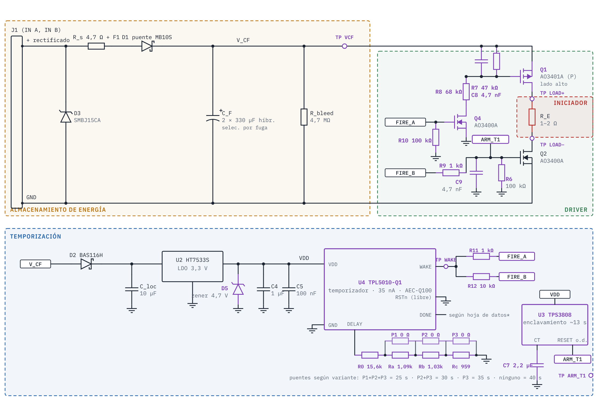
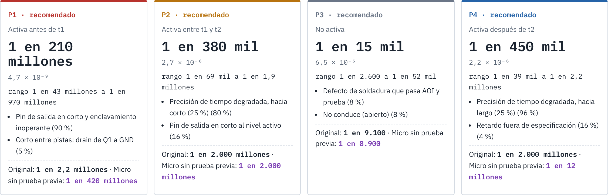
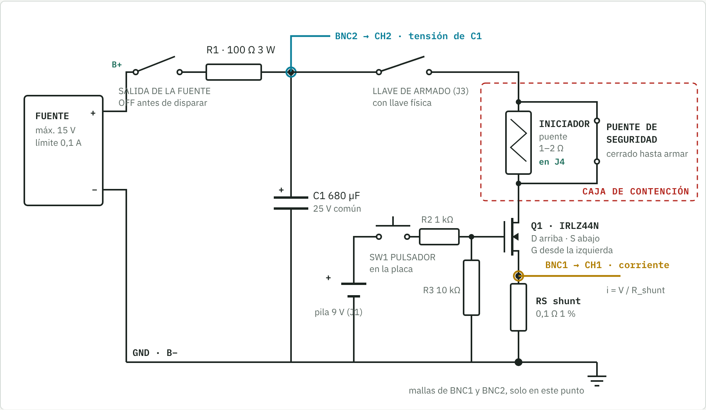
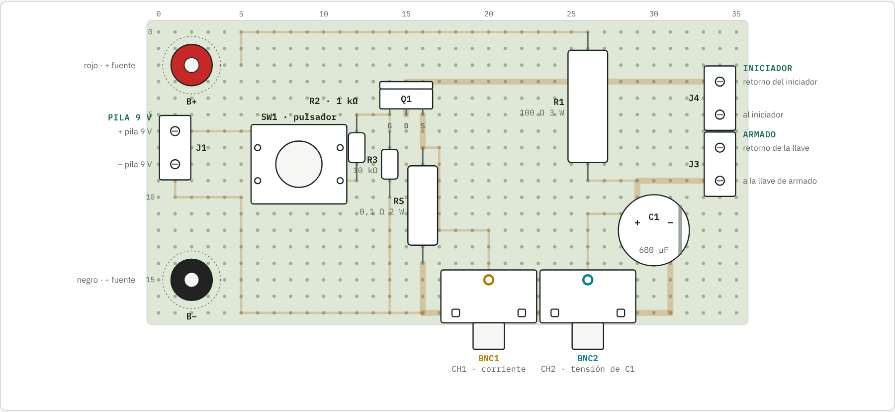
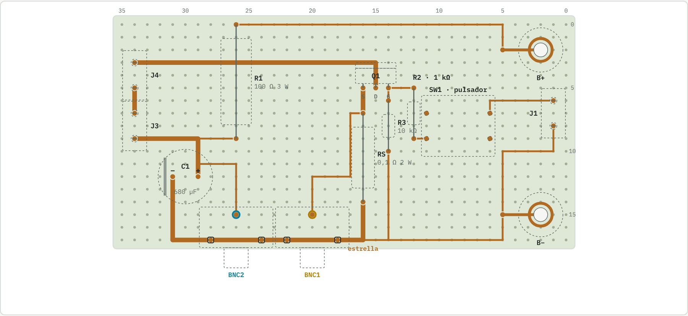

# Cómo leer este resumen

Resume todo lo trabajado en el chat, en el orden en que se fue decidiendo. Los números son los del último estado del modelo. Donde un resultado cambió en el camino, figura el valor final y, si importa, por qué cambió.

Materiales que acompañan este documento (carpeta `retardo/` del repositorio, rama `claude/gracious-gates-saqie1`):

| Archivo | Qué es |
|---|---|
| `probabilidad-fallos.html` | Informe principal: modelo P1–P4, alternativas 0/A/B/C/D, revisión contra hojas de datos, estudio del capacitor, precio y auditoría. Interactivo. |
| `banco-i2t.html` | Banco para medir el I²t del iniciador: esquema, procedimiento, calculadora de tensión de carga, planilla de disparos y materiales. |
| `placa-banco-i2t.html` | Circuito del banco y su armado en placa perforada (lado componentes y lado cobre), materiales, armado y verificación. |
| `generar_placa_banco.py` | Genera la página de la placa y verifica automáticamente el conexionado (todas las redes). |
| `montecarlo_energia_tabla.py` | Monte Carlo de la energía entregada al iniciador (10⁶ casos) para cada C_F. |
| `montecarlo_fallos.py`, `analisis-probabilidad-fallos.md` | Primera versión del análisis (22/11), con el diseño original con micro. |
| `resumen-chat/` | Este resumen (.docx y .md), las imágenes, los prompts para ChatGPT y los dos documentos de diseño con que empezó el chat. |

Versiones publicadas (privadas hasta que se compartan desde el menú Compartir):

- Informe: <https://claude.ai/artifact/8EjWvaViRVAVkVaR1Mo1xc>
- Banco de I²t: <https://claude.ai/artifact/9uZELAhZhJHhB4ZNwgtQLU>
- Placa del banco: <https://claude.ai/artifact/RUjDnNXeKwGqGtdoZng1Ro>

No se compartieron imágenes en el chat. Las imágenes de este resumen se generaron a partir de las páginas.

# 1. Punto de partida

Se partió de dos documentos de diseño del retardo autoalimentado (incluidos en `documentos-de-partida/`): un pulso de 12 V carga un capacitor (C_F), un micro con cristal cuenta T y dos MOSFET del lado bajo conectan el iniciador.

El pedido fue estimar la probabilidad de cada modo de falla, sin ponderarlos por gravedad:

| Código | Evento |
|---|---|
| P1 | Activa antes de t1 (≈ 4 s) |
| P2 | Activa entre t1 y la ventana (temprano) |
| P3 | No activa |
| P4 | Activa después de la ventana (tarde) |

Requisitos que se fueron fijando durante el chat:

- Ventana de disparo **30 s ± 5 s**; variantes de 25, 30, 35 y 40 s por puentes.
- Almacenamiento de **2–3 años** (se calcula con 3), **sin prueba antes del uso**.
- El cableado y el montaje del cliente quedan **fuera del cálculo**.
- El usuario puede **invertir la polaridad** de la entrada.
- Sobretensión: **proteger sin bloquear** el disparo.
- Baja tensión: con un pulso de **~9 V o menos no carga ni arranca nada**.
- Preferencia por **12 V** frente a 24 V.
- Probabilidades expresadas como **"1 en N"**.
- Precios en **JLCPCB/LCSC** y **puestos en Argentina** (× ~1,19 por derechos, tasa y despachante).

# 2. El modelo de probabilidad

- Cada modo de falla de cada pieza es una fila (~100 filas), más fabricación, ambiente y operación. Cada fila dice si produce P1, P2, P3, P4 o nada.
- **P = λ · 10⁻⁹ · f · horas · c**: λ es la tasa de falla (FIT), f la fracción de ese modo, c la probabilidad condicional de que produzca el efecto.
- **Horas equivalentes** = k_d · años · 8760. k_d es el factor de reposo: 1/60 con almacenamiento controlado (1/30 sin controlar), según Harris. Con 3 años controlados son **438 h**.
- **λ central** = media geométrica entre el dato bajo (fabricante) y el alto (MIL-HDBK-217F). Cada dato lleva una nota de respaldo: A (dato publicado de la pieza), B (norma o pieza equivalente), C (supuesto razonado), D (hay que medirlo).
- Dos canales: falla común β = 2 % (rango 1–5 %).
- Energía: Monte Carlo de 10⁶ casos con todas las tolerancias (pulso, C_F, puente, ESR, llaves, fuga, frío).
- **Auditoría (sección 9 del informe):** el modelo sirve para **comparar configuraciones y decidir prioridades**, no para dar valores absolutos. P1 y P3 tienen alrededor de un orden de magnitud de incertidumbre.

# 3. Cómo evolucionó el diseño

1. **Original** (documento de diseño): micro + cristal, dos llaves del lado bajo. Hallazgo: el corto a masa del cable del iniciador saltea las dos llaves. Luego se acordó que ese corto es del montaje del cliente y se sacó del cálculo.
2. **Mejorado:** llave del lado alto (P-MOS) manejada por un N-MOS, clamp de VDD, pull-downs de 10 kΩ con C_GS, **enclavamiento de t1 con U3 (TPS3808)**, que solo puede tirar el gate a masa, así que puede impedir un disparo pero nunca provocarlo. P1 bajó ~400 veces respecto del original.
3. **Recomendado con micro:** sin cristal, con autoprueba antes del uso. Se descartó porque **el cliente no puede probar antes del uso**.
4. **Temporizador sin micro:** con la ventana de ±5 s la precisión deja de ser un problema. Se eligió primero el **TPL5110-Q1** (AEC-Q100, 4 FIT publicados por TI, 35 nA). T se fija con **una cadena de resistores y puentes de 0 Ω** montados en fábrica (más confiable que cortar o soldar a mano).
5. **Búsqueda de alternativas** (con prompts para ChatGPT y verificación contra hojas de datos): ningún candidato superó al temporizador de TI. Los supervisores con retardo por capacitor (ABLIC S-19100, TPS3808) varían demasiado con la temperatura para contar 30 s.
6. **Hallazgo crítico:** la salida DRV del TPL5110 arranca en alto, que es justo el nivel de disparo. Se cambió al **TPL5010-Q1**, cuya salida WAKE arranca en bajo y da **un único pulso** al cumplirse T.
7. **Revisión profunda de la alternativa A contra hojas de datos**, con estas correcciones:
   - salida del temporizador: TPL5110 → TPL5010;
   - 2N7002 → AO3400A, porque el umbral de hasta 2,5 V del 2N7002 no alcanza con 3,3 V;
   - diodo SS34 fuera, por su fuga;
   - especificación de fuga de C_F;
   - pin SENSE del TPS3808 a VDD (abierto deja el RESET activo y no dispara nunca);
   - divisores de gate rehechos (R11 1 kΩ, R12 10 kΩ, R6 y R10 100 kΩ);
   - análisis de peor caso de tiempo, energía y gates, derating y condiciones anormales.
8. **¿Alcanza el pulso WAKE de 20 ms?** Sí: C_F se descarga en unos pocos milisegundos (τ ≈ 1,55 ms con 660 µF). Se evaluó un retén de las llaves con transistores y **se descartó**: no mejora ninguna probabilidad, suma piezas y deja las llaves cerradas después de un no-disparo.
9. **Entrada:** puente de diodos (polaridad indistinta), en el orden **F1 (PTC) → R_s 4,7 Ω → TVS SMBJ15CA de 600 W → puente**. Protege ante sobretensión sin impedir el disparo. El bloqueo por sobretensión se quitó a pedido.
10. **Bloqueo de carga por baja tensión (Q_in + TL431):** con un pulso de ~9,5 V o menos, C_F no carga y no arranca nada. Reemplazó a un bloqueo anterior por la tensión de C_F que, con el umbral en 8 V, impedía el disparo en 2 de cada 1000 usos normales (lo mostró el Monte Carlo).
11. **24 V (alternativa D):** no baja P3, porque P3 depende de las fallas de las piezas, no del margen de energía. A 12 V se consigue el mismo margen más barato con un C_F más grande. Se mantuvo **12 V**.
12. **C_F final: 2 × híbrido Panasonic EEHZC1E331P (660 µF)** (sección 5).

# 4. Resultados

| Alternativa | P1 (antes de t1) | P2 (temprano) | P3 (no activa) | P4 (tarde) | FOB | Puesta en Argentina |
|---|---|---|---|---|---|---|
| 0 · Sin medidas | 1 en 50 mil | 1 en 230 mil | 1 en 16 mil | 1 en 230 mil | 1,59 USD | 2,32 USD |
| **A · Recomendada** | **1 en 210 millones** | **1 en 380 mil** | **1 en 15 mil** | **1 en 450 mil** | **2,06 USD** | **2,88 USD** |
| C · Con micro PY32 | 1 en 420 millones | 1 en 2.000 millones | 1 en 7.900 | 1 en 12 millones | 1,65 USD | 2,40 USD |
| D · 24 V | 1 en 220 millones | 1 en 380 mil | 1 en 16 mil | 1 en 450 mil | 2,17 USD | 3,02 USD |
| B · Dos canales | 1 en 130 millones | 1 en 380 mil | **1 en 770 mil** | 1 en 510 millones | 2,44 USD | 3,34 USD |

Lote de 1000 placas pedidas en panel, 3 años de almacenamiento controlado y tasas centrales. Los precios de C, D y B se calcularon con un solo C_F de polímero: con los dos híbridos de A suman ~0,5 USD.

- **A frente a sin medidas:** P1 baja unas 4000 veces. P3 queda casi igual, porque lo dominan las fallas de las piezas durante el almacenamiento.
- **Con un solo canal, P3 no baja de ~1 en 220 mil**, aunque se refuerce todo: el temporizador solo ya aporta ~1 en 230 mil. Para acercarse a 1 en 1 millón hace falta **un segundo canal distinto** (B), con su propio C_F y llaves.
- **C (micro)** empeora P3 porque Puya no publica datos de falla del micro y el modelo usa la tasa alta de MIL-HDBK-217F.
- **Medidas en A** (cada una con su efecto y costo en la sección 2.4 del informe): llave del lado alto, enclavamiento U3, clamp de VDD, pull-down reforzado y C_GS, R_s anti-pulso, almacenamiento controlado, puente de entrada, protección de entrada y bloqueo de carga.

# 5. Capacitor de almacenamiento (C_F)

**Qué tiene que cumplir:**

- entregar al menos el doble del all-fire del iniciador en el peor caso, después de 40 s;
- consumir en total ≤ ~47 µA durante la espera (pulso de 10,8 V) o ≤ ~61 µA (12 V);
- no aumentar su fuga después de 3 años sin tensión ni con humedad;
- funcionar de −30 a +70 °C y soportar vibración y caídas.

| Tecnología | Fuga garantizada | Después de guardado / humedad | Veredicto |
|---|---|---|---|
| Polímero sólido | 0,1–0,2·C·V (mA) | Sube con humedad | No |
| **Híbrido** | 0,01·C·V (165 µA a 25 V para 2 × 330 µF; a 11 V, pocos µA) | Estable: el electrolito repara el óxido | **Adoptado** |
| Electrolítico de baja fuga | ~0,002·C·V | La primera carga después de guardado pide mucho más | Respaldo |
| Tantalio | 0,01·C·V | Estable | No: falla en corto |
| Cerámico (MLCC) / film | Casi nula | Estable | No: tamaño |

**ESR:** es la resistencia interna del capacitor y se suma al puente del iniciador. Con el híbrido (20–30 mΩ) resta ~1 % del I²t; 0,3 Ω restarían ~11 %.

**Qué aumenta la fuga con el tiempo:**

- la humedad;
- el almacenamiento sin tensión (la primera carga después de 3 años es justo la del uso);
- la temperatura;
- los golpes o la flexión de la placa;
- los restos de flux sobre la placa.

**Diseño final con 2 × 330 µF híbrido (660 µF):**

- **Energía:** el peor caso dentro de especificación entrega **5,4 A²·ms**; la mediana es **18 A²·ms**.
- **Monte Carlo:** energía insuficiente < 10⁻⁶ hasta **6,5 A²·ms**. Con 470 µF de polímero la referencia era 5 A²·ms.
- **Redundancia parcial:** si un capacitor queda abierto, el otro todavía entrega ~6 A²·ms con el pulso nominal.
- **Protección contra la humedad:** placa lavada, barniz o encapsulado blando, y bolsa barrera con desecante.
- **Selección al 100 %:** caída ≤ 0,8 V en 30 s a 11 V (≈ 17 µA en total).
- **Calificación del lote:** fuga en la primera carga después de 1000 h a 85 °C o en humedad, sin tensión.
- **Equivalentes si no hay EEHZC1E331P:** Panasonic ZA/ZK/ZE, Chemi-Con HXD/HXE, Nichicon GYA. No reemplazarlo por polímero sólido.

# 6. Mecánica (vibración, choque, caídas)

- **Todo SMD:** es más robusto y más barato que agujero pasante. Solo los cables de entrada y salida van en agujeros pasantes, con alivio de tensión.
- **Encapsulado blando** (poliuretano o silicona), que no tape la válvula de los capacitores.
- **C_F en versión antivibración** (sufijo V de Panasonic) o pegado.
- **Cerámicos con terminación flexible**, lejos del borde de corte del panel.
- **PCB de 1,6 mm.**
- **Ensayos:** IEC 60068-2-6 (vibración), -27 (choque) y -31 (caída), por ejemplo en INTI.

# 7. Fabricación y pruebas

- **Pedirlo en panel** de ~30 placas, con orificios de ruptura (no V-cut) y bordes de 5 mm. JLCPCB cobra un **mínimo de 0,46 USD de armado por placa**: pedidas sueltas, 1000 placas salen ~250 USD más caras. Las placas se separan con herramienta, nunca doblando a mano.
- **Rayos X:** no hace falta, porque todas las soldaduras quedan a la vista (≈ 0,25 USD por placa a 1000 unidades).
- **Capas de prueba:**
  - calificación del diseño (20–50 placas, destructiva);
  - aceptación de cada lote;
  - prueba al 100 % en banco.
- **Prueba de producción:** disparo real sobre un **resistor de 2 Ω medido a 4 hilos**, verificando T, enclavamiento, fuga de C_F, cada llave por separado y corriente antes de tiempo.
- **Banco de una placa:** 300–500 USD.
- **Banco de panel:** 700–1200 USD, con 30 ranuras baratas e instrumentos compartidos.
- **Qué detecta el banco:** los defectos de fabricación. No detecta lo que se rompe durante el almacenamiento, que es la mayor parte de P3.
- **Programación** (cuando el diseño tenía micro): JLCPCB cobra ≈ 0,04 USD por placa. Programar en el banco propio no cuesta nada extra.

# 8. Banco para medir el I²t del iniciador

**Por qué hace falta:** el all-fire del iniciador es el dato que falta. Define el margen de C_F.

**Método:**

- descargar un capacitor común de **680 µF** (τ ≈ 1,5 ms, como el diseño) sobre el iniciador, a través de un **shunt de 0,1 Ω**;
- medir la corriente con el osciloscopio: **I²t = I_pico² · τ / 2**;
- el dato clave es el **I²t hasta funcionar**: I_pico² · τ/2 · (1 − e^(−2·t_f/τ)), donde t_f es el instante en que se abre el puente;
- **escalera de energía:** empezar en ~0,5 A²·ms y subir ~10 % por disparo; después 10–20 disparos con iniciadores nuevos (método Bruceton);
- **lectura del resultado:** si el all-fire es ≤ 2,7 A²·ms, los 660 µF dejan al menos el doble de margen.

**Instrumentos considerados:**

- osciloscopios FNIRSI 2C53P y Hantek 6022BE;
- banco propio con ADC: ADC interno del STM32 (Black Pill / NUCLEO-F446RE), **AD7606** (16 bits, 200 kSPS, muestreo simultáneo; el mejor disponible en MercadoLibre) y ESP32 con el AD7606 a ~50 kSPS;
- el ADS1256 sirve para medir fuga, no para el pulso.

Al final **conseguiste una fuente regulable y un osciloscopio UNI-T**, así que se mide directo con el osciloscopio. El banco con ADC queda para más adelante.

**Placa del banco (versión final):**

- placa perforada de 36 × 18 agujeros (~92 × 46 mm), sin cables sueltos;
- todas las pistas de un solo lado y sin cruces, con el conexionado verificado por programa;
- **BNC hembra para placa a 90°** en el borde de abajo:
  - BNC1 = corriente, con medición Kelvin del shunt;
  - BNC2 = tensión de C1;
- **bornes banana** rojo y negro para la fuente;
- **pulsador táctil de 12 × 12 mm soldado en la placa**;
- borneras para la pila de 9 V, la llave de armado y el iniciador;
- Q1 IRLZ44N, C1 680 µF 25 V, RS 0,1 Ω 2 W, R1 100 Ω 3 W, R2 1 kΩ, R3 10 kΩ.

**Correcciones de la revisión de la placa:**

- fuente y pulsador separados (juntos, un error de cableado podía disparar);
- separación de patas acorde al tamaño real de R1 y RS;
- fuente a **15 V máximo y 0,1 A**, porque C1 es de 25 V;
- **salida de la fuente en OFF antes de armar**.

**En el osciloscopio:**

- los dos canales con atenuación ×1 y acoplamiento DC;
- CH1 a 100–200 mV/div;
- CH2 a 2–5 V/div;
- base de tiempo 0,5 ms/div, disparo único.

**Seguridad:**

- llave de armado y puente de seguridad sobre el iniciador;
- caja de contención y disparo a distancia;
- personal habilitado (ANMaC).

**Para Electrónica Mendoza:**

- 2 BNC para placa a 90°;
- 2 cables BNC–BNC;
- bornes banana rojo y negro, y cables banana;
- 2 resistores de 0,1 Ω 2 W;
- 1 resistor de 100 Ω 3 W;
- alambre estañado de 1 y 0,5 mm;
- 3 borneras de paso 5 mm;
- 2 pulsadores táctiles de 12 × 12 mm;
- placa perforada de 10 × 5 cm;
- IRLZ44N, 680 µF 25 V, 1 kΩ, 10 kΩ, llave de armado, broche de 9 V, resistor de 2,2 Ω 5 W para validar.

# 9. Compras en MercadoLibre (búsquedas del 25/11)

Precios tomados del buscador; pueden haber cambiado.

- **Osciloscopio FNIRSI 2C53P:** ~$184.000–330.000 (ya no hace falta).
- **Módulo AD7606:** ~$47.000 (vendedor Starwarecomar).
- **NUCLEO-F446RE:** ~$75.000–120.000. Es placa original de ST con ST-Link incorporado y reemplaza a la Black Pill + ST-Link.
- **Aislador USB ADuM3160:** genérico ~$28.000; DSD Tech ~$72.000–89.000.
- **Multímetro UNI-T UT61E+** (tienda oficial): ~$193.000–210.000.
- **Fuentes de 30 V 5 A:** UNI-T ~$171.000; Etheos ~$79.000–159.000.
- **Tu ST-Link V2 clon** sirve para programar. Si no conecta, la Black Pill también se programa por USB (DFU).
- Los prompts completos para ChatGPT están en `prompts-chatgpt.md`.

# 10. Pendientes

1. **Medir el all-fire del iniciador** con el banco. Es el dato que define el margen de C_F.
2. Confirmar la fuga real de los híbridos a 11 V después de un almacenamiento acelerado, en la primera carga.
3. Medir en banco el pulso WAKE (≥ 15 ms), la deriva de T y el retardo de U3 a −30 y +70 °C.
4. Verificar el umbral del bloqueo de carga (9 V no carga, 10 V sí) y la TVS con un pulso de 24 V × 300 ms.
5. Esquemáticos de B y D si se reflotan.
6. Ensayos de vibración y choque de la placa encapsulada.
7. Pedir a los fabricantes los datos de falla que faltan (por ejemplo, el FIT del micro si se usa C o B).
